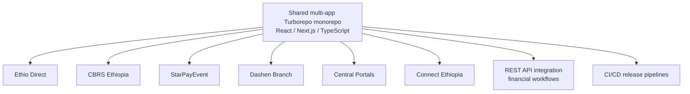

# Hi, I'm Mahlet Wondwosen Tegene

**Senior Frontend Developer** in Addis Ababa, Ethiopia. I build and integrate bank and financial portals and mini-apps at EagleLion Systems Technology, working in a large multi-app Turborepo monorepo with backend, QA and platform teams. MSc candidate in Software Engineering at Addis Ababa University.

## What I work on

Details of my production work are in [fintech-platform-work](https://github.com/mahiamu/fintech-platform-work).

## Tech stack

| Area | Tools |
| --- | --- |
| Frontend | React, Next.js, TypeScript, JavaScript, Angular, React Native |
| Data | MySQL, MongoDB, Firebase, NATS JetStream |
| Practice | Git, Docker, CI/CD, GitOps, Turborepo, Swagger/OpenAPI, Agile/Scrum |
| Reliability | Observability (tracing, metrics, structured logs), SLO design, QA |

## Research

MSc thesis: *A Framework to Optimize Communication in Distributed Scrum Teams*. I designed and evaluated COIF, an event-driven middleware layer with ceremony-specific SLOs, exactly-once delivery, schema compatibility checks, retry and dead-letter recovery, and full observability. A study across two distributed teams showed statistically significant gains in reliability and delivery time.

## Experience

- **Senior Frontend Developer**, EagleLion Systems Technology (2025 to present)
- **Intermediate Software Developer**, Binget Group (2024 to 2025)
- **Software Developer**, Charis Technologies (2023 to 2024)
- **Junior Software Developer**, CREAVERS Service PLC (2022 to 2024)

## Personal projects

- [crime-analysis-and-management-system-](https://github.com/mahiamu/crime-analysis-and-management-system-): MERN stack system built during my internship at INSA
- [burger-builder](https://github.com/mahiamu/burger-builder): React app for building a custom burger order
- [hms3](https://github.com/mahiamu/hms3): C# hospital management system
- [Task-Management](https://github.com/mahiamu/Task-Management): task management app
- [Betgebey](https://github.com/mahiamu/Betgebey): JavaScript web app

## Connect

[LinkedIn](https://www.linkedin.com/in/mahlet-wondwosen) | [Portfolio](https://my-portfolio-dashboard-5d613.web.app/)
